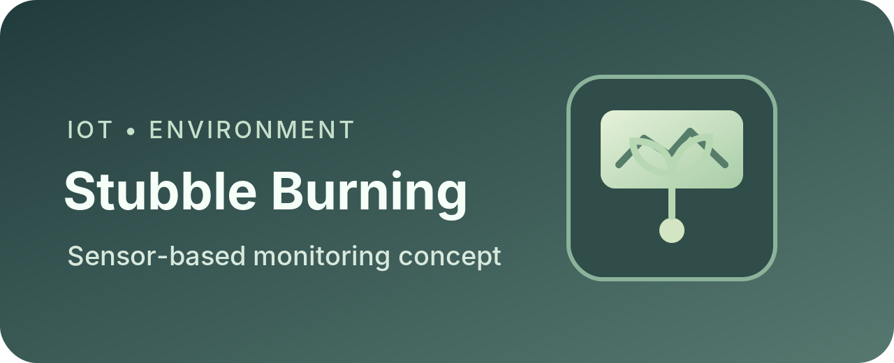
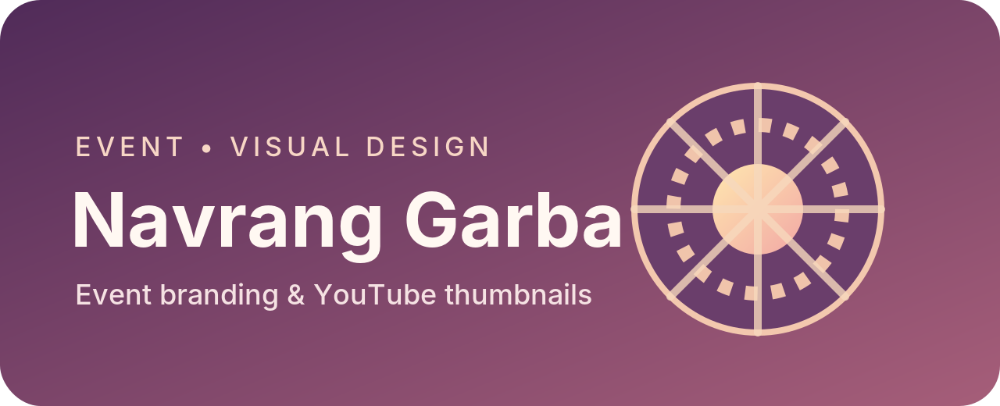

<!--
GitHub Profile README — Utkarsh Tripathi (@pantherliftz777)
IMPORTANT: Keep README.md and all PNG files in this same repository root.
Repository name must exactly match your GitHub username: pantherliftz777
-->

  

<h1 align="center">Hey, I'm Utkarsh Tripathi 👋</h1>

  

  <em>Building thoughtful solutions through code, data, and curiosity.</em>

  
  
  

---

## 🧑‍💻 About Me

I'm **Utkarsh Tripathi**, a Computer Science and Engineering student specializing in **Data Science** at **Gautam Buddha University, Greater Noida** (expected graduation: **2029**).

I'm interested in building practical technology solutions and exploring the intersection of **software development, Artificial Intelligence, and Data Science**. I enjoy learning by building, experimenting with new tools, and turning ideas into useful applications.

- 🎓 Pursuing **B.Tech in Computer Science & Engineering (Data Science)**.
- 🔭 Developing **FitFuel**, a fitness and wellness platform with workout planning, activity tracking, and AI-assisted features.
- 🌱 Strengthening my foundations in **Python, Data Structures & Algorithms, AI/ML, and web development**.
- 🧩 Interested in **AI-powered applications, full-stack development, data-driven products, and IoT**.
- 🤝 Open to collaborating on student, open-source, and beginner-friendly technology projects.
- 💬 Happy to discuss Python, Java, C, web development, project ideas, and learning resources.

---

## 🛠️ Skills & Technologies

### Languages, development & tools

  

### Libraries & areas I'm exploring

  
  
  
  
  

---

## 🚀 Projects & Work

A selection of software, AI, IoT, and digital-creative work I've explored. Some are active development projects, while others are academic or creative initiatives; I label them accordingly.

<table>
  <tr>
    <td width="50%" valign="top">
      
      <h3>FitFuel — Fitness & Wellness Platform</h3>
      
<strong>Status:</strong> In development

      
A fitness platform bringing workout planning, activity tracking, fitness analytics, and AI-assisted guidance together. Planned capabilities include posture/body assessment workflows, exercise recommendations, and interactive dashboards.

      
<strong>Tech explored:</strong> HTML, CSS, JavaScript, Node.js, SQLite, AI integration.

    </td>
    <td width="50%" valign="top">
      
      <h3>Smart AI Scam Detection</h3>
      
<strong>Context:</strong> Hackathon project

      
An AI-oriented cybersecurity project focused on identifying potentially fraudulent activity and helping people recognize digital scams. The project explores applying intelligent techniques to a practical digital-safety problem.

      
<strong>Focus:</strong> AI/ML concepts, scam detection, cybersecurity.

    </td>
  </tr>
  <tr>
    <td width="50%" valign="top">
      
      <h3>IoT-Based Stubble Burning Detection</h3>
      
<strong>Context:</strong> Academic / IoT project

      
An environmental-monitoring system concept using sensor data to observe air quality and surrounding conditions associated with stubble burning, with GPS-based location information.

      
<strong>Components explored:</strong> NodeMCU ESP8266, MQ-135, DHT11, NEO-6M GPS, OLED display, Blynk.

    </td>
    <td width="50%" valign="top">
      
      <h3>University Management & Attendance System</h3>
      
<strong>Context:</strong> Python desktop application

      
A desktop application concept for organizing university records and attendance workflows, including student, teacher, and course management, timetable organization, attendance records, and CSV export.

      
<strong>Tech stack discussed:</strong> Python, Tkinter, SQLite, CSV.

    </td>
  </tr>
  <tr>
    <td width="50%" valign="top">
      
      <h3>Kavirox.space</h3>
      
<strong>Type:</strong> Website / digital-business initiative

      
A digital presence initiative explored around website development, digital marketing, brand positioning, and helping businesses strengthen their online presence.

      
<strong>Focus:</strong> Web solutions, branding, digital strategy.

      
<a href="https://kavirox.space">Visit Kavirox.space</a>

    </td>
  </tr>
</table>

### Additional creative work

  

**Navrang Garba — Event Creatives:** Event-related visual content, including YouTube thumbnail composition, image arrangement, and event branding.

> **Project note:** Some projects are ongoing, exploratory, or creative initiatives. Repository and demo links will be added when a public, shareable version is available. Planned features are not presented as completed functionality.

---

## 📊 GitHub Statistics

  
  

  

  <picture>
    <source
      media="(prefers-color-scheme: dark)"
      srcset="https://raw.githubusercontent.com/pantherliftz777/pantherliftz777/output/github-snake-dark.svg" />
    <source
      media="(prefers-color-scheme: light)"
      srcset="https://raw.githubusercontent.com/pantherliftz777/pantherliftz777/output/github-snake.svg" />
    
  </picture>

---

## 🎓 Education & Learning

**Gautam Buddha University, Greater Noida**  
B.Tech — Computer Science & Engineering (Data Science)  
Expected graduation: **2029**

Currently building foundations in:

- Programming and problem solving with Python, Java, and C.
- Data Structures & Algorithms.
- Probability, statistics, and scientific computing.
- Artificial Intelligence and Machine Learning fundamentals.
- Web development, APIs, and database-backed applications.

---

## 🌱 What I'm Working Towards

I want to become a strong software developer with the ability to design, build, and improve useful products. My current focus is on consistent coding practice, strengthening computer-science fundamentals, and completing projects that demonstrate real implementation rather than just ideas.

---

## 🤝 Connect With Me

  
  <!-- Add your LinkedIn and professional email links here when ready. -->

<em>Thanks for stopping by. Feel free to explore my repositories and follow along as I learn, build, and grow. ✨</em>

  

